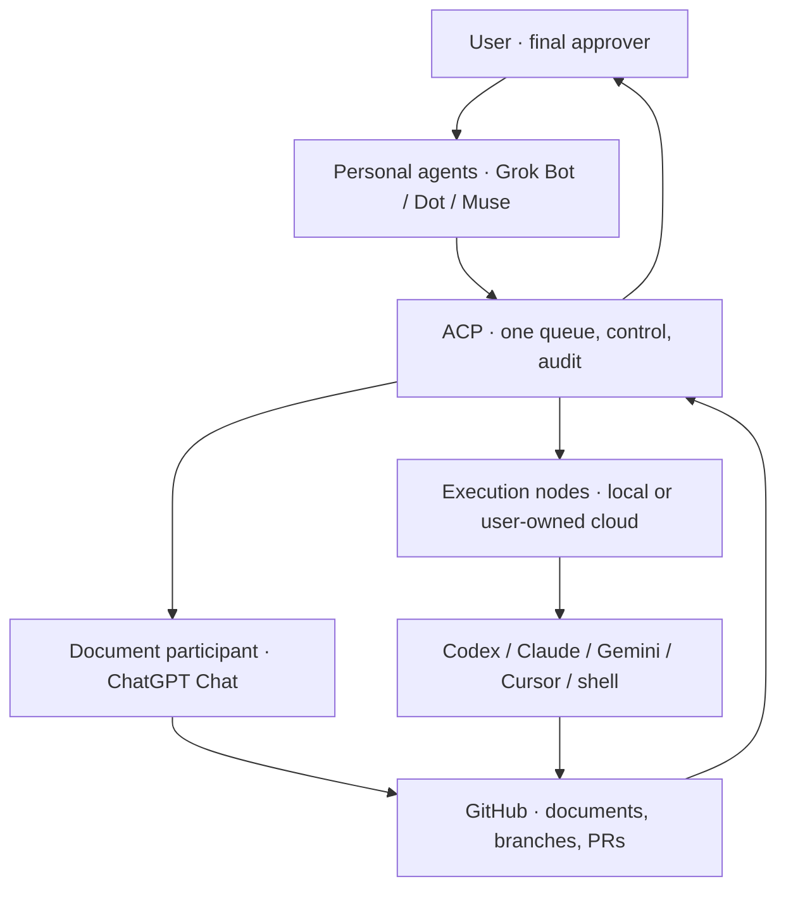

# AgentControlPlane V1.0 — Engineering Design & Codex Implementation Plan

> **For agentic workers:** REQUIRED SUB-SKILL: Use `superpowers:subagent-driven-development` (recommended when available) or `superpowers:executing-plans` to implement this plan task-by-task. Implementation steps use `- [ ]` checkboxes. If these skills are unavailable, follow the repository's `AGENTS.md` and execute each task with the same test/review gates.

**Goal:** Upgrade the existing local-first AgentControlPlane into a control center that accepts one or more personal AI agents, tracks subscription availability across vendors, routes engineering work between local/cloud executors, and closes the development loop through GitHub PRs with human approval.

**Architecture:** Preserve the existing MCP northbound interface, executor lifecycle, task store, audit and cross-executor continuation. Add optional, provider-neutral controller admission, subscription-status snapshots, execution-node selection and GitHub delivery metadata. Keep the single logical queue and one active writer per task; never put source code or subscription credentials on the author's website by default.

**Tech Stack:** Existing Node.js >=22, ESM, MCP SDK, Zod, `node:test`, current GitHub repository and local CLI executors. No new mandatory hosted database, paid model API or Notion service.

**Spec:** The specification is Sections 1–11 of this document. The executable first-PR plan is Section 13. When imported into GitHub, place this file at `docs/ACP_V1_ENGINEERING_DESIGN.md`; preserve the document alongside the implementation so agents can reread its decisions.

**Prepared:** 2026-11-01 · **Status:** proposed; no code or GitHub configuration has been changed by this document.

**Repository:** `https://github.com/Ya-KARAS/AgentControlPlane` · default branch `main` · reviewed release `v0.9.3`. Recheck the actual main HEAD and working-tree diff before execution.

---

## 1. Product decision / 产品定位

**ACP = 本地优先、厂商中立的私人 Agent 与工程执行器控制中心。**

The user is the final approver. Personal agents (Grok Bot, Dot, Muse, and later additions) are optional controllers, not mandatory model dependencies. An agent may work alone, cooperate with others, or be the designated primary while another takes over after a verified timeout. Codex, Claude Code, Gemini/Antigravity, Cursor and other compatible tools are execution candidates; direct shell/computer-use execution by a personal agent is another **explicitly permissioned** capability, not an implicit privilege.

**Stable decisions:**

1. Keep the technical project/repository name `AgentControlPlane` and internal nickname ACP. Defer external product branding.
2. Keep **GitHub + ACP** as the two required platforms. Notion is optional, never a dependency.
3. Continue from the existing codebase, do not rewrite it. Preserve Node.js >=22 and AGPL-3.0 licensing.
4. Use existing subscription-capable CLIs when supported; no **new mandatory pay-per-token model API**. Actual subscriptions and cloud hosts may still have costs/limits.
5. Have **one logical task queue**; controller multiplicity does not create duplicate queues or tasks.
6. Keep project code, test output, absolute paths, API keys, browser session material and CLI credentials local to the chosen user-owned execution node.
7. Use a per-task branch and PR; **only the user approves merging into `main`**. Successful tests are not merge authorization.
8. Home PC need not be powered on 24/7. Work continues only if an authorized, compatible cloud runner actually exists and is online; otherwise the task remains queued or blocked.
9. Retain existing AsterRoute portal support as an **optional transport**. A user's engineering data must not be required to pass through `acp.asterroute.com` or an operator-owned central service.
10. The ordinary ChatGPT **Chat** surface is a document/planning participant, not an assumed callable API. Browser automation requires a separate feasibility/security acceptance gate; do not promise unattended official-chat handoff.

## 2. Existing baseline / 不重复开发的功能

The reviewed `main` already exposes:

| Existing capability | Existing location / evidence | V1 action |
|---|---|---|
| MCP dispatch, status, continuation, handoff | `src/mcp/server.js`, `docs/PROTOCOL.md` | Extend compatibly |
| Task persistence, idempotency, audit, logical lineage | `src/core/store.js`, `src/core/orchestrator.js` | Extend current records; no second store |
| Local executor adapters and discovery | `src/executors/`, `src/executors/lifecycle.js` | Reuse adapter boundary |
| Explicit cross-executor handoff | `docs/P1-CROSS-EXECUTOR-CONTINUATION-DESIGN.md` | Reuse; do not duplicate |
| Usage/event accounting for executed tasks | `src/core/usage-events.js`, `src/core/usage-dimensions.js` | Keep **separate** from subscription limits |
| Browser companion and ChatGPT connection | `browser-companion/`, `userscript/`, `docs/CHATGPT-CONNECTION.md` | Incremental adapters only |
| Device relay / outbound worker | `src/remote-relay/worker.js`, `docs/REMOTE-DEVICE-RELAY.md` | Make optional, secure and nonexclusive |
| Dashboard, tests and common verification | `src/dashboard.js`, `tests/`, `npm run verify` | Add small components/tests |

Existing automatic executor reroute is **experimental, disabled by default**. It must not be silently represented as production-ready. Existing local state uses a bounded JSON task store; it is **not** a distributed transaction database.

## 3. Target topology / 目标架构



**Control plane:** trusted controller identity → intent/approval → admission → single task record → executor selection → status/evidence → human review.  
**Execution plane:** local or remote *user-owned* node → selected executor → isolated workspace/project branch → tests → evidence and GitHub PR.  
**Storage plane:** ACP stores local operational state and bounded safe telemetry; GitHub stores versioned code, engineering docs and accepted PR history.

The diagram expresses *roles*, not guaranteed automatic connectivity. ChatGPT ordinary Chat, cloud CLI sessions and graphical Cursor automation need individual compatibility tests.

## 4. Personal-agent layer / 私人 Agent

Supported operating modes:

| Mode | Behavior | Safety rule |
|---|---|---|
| `single` (default) | Any one chosen personal agent dispatches/monitors | Only that trusted controller owns the task |
| `cooperative` | Multiple agents may propose plans/reviews; one active controller owns changes to a given task | Other agents cannot concurrently dispatch the same work |
| `failover` | Another registered controller takes ownership after an expired **controller** lease and verification | It inherits the same logical task/evidence; no duplicate executor turn |

**Never treat model-generated identity text as authorization.** Controller identity must derive from an authenticated MCP/browser/API channel or a trusted local operator configuration, not an arbitrary `controller_id` supplied in a prompt. Unknown identities have read-only or approval-required access.

Minimum controller metadata (optional to preserve existing callers):

```json
{
  "controller": {
    "id": "personal-dot",
    "kind": "mcp",
    "display_name": "Dot",
    "mode": "single",
    "authenticated_principal": "locally-bound-identity"
  }
}
```

`authenticated_principal` is a conceptual security boundary, **not** a request field clients can self-assert. Do not put tokens or account identifiers in task-visible summaries. Preserve `src/controllers/controller.js` existing fields and add optional metadata only after tests prove compatibility.

## 5. Task and ownership / 单队列与防重

Reuse the existing task status vocabulary (`queued`, `running`, `completed`, `partial`, `blocked`, `failed`, `cancelled`), `logical_task_id`, `parentTaskId`, `executor_history`, `idempotency_key`, `continuation`, and project registry. Do not create a second task database.

Proposed **optional** record additions, using backward-compatible defaults:

```json
{
  "controller": {"id": "personal-dot", "mode": "single"},
  "control_lease": {
    "owner": "personal-dot",
    "generation": 1,
    "expires_at": "2026-11-01T12:02:00Z"
  },
  "execution_node_id": "local-desktop",
  "delivery": {
    "repository": "Ya-KARAS/AgentControlPlane",
    "branch": "feat/acp-task-123",
    "pull_request_number": null,
    "head_sha": null,
    "checks": "unknown",
    "review_state": "not_requested"
  }
}
```

- A controller lease governs **who may amend a task**, not the underlying executor process. Controller takeover must never launch a second executor against a live workspace.
- `generation` is a fencing counter: a stale controller cannot renew/release or mutate after ownership changes.
- The server is the clock authority. For initial local deployment, one ACP scheduler process owns the store. A later multi-node mode needs an independently proven atomic ownership mechanism; do **not** share `state.json` between PCs or assume GitHub comments are distributed locks.
- Existing `idempotency_key` must deduplicate identical dispatch retries. Conflicting content with the same key remains an error.
- The user may cancel or explicitly override ownership at any time; record a safe audit event.
- Add execution-node and delivery state separately from existing executor task `status`, so completing code does not imply PR acceptance.

## 6. Subscription monitoring / 订阅额度监控

**Objective:** display *availability*, reset time and freshness across providers, then allow safe routing. Do not claim every plan exposes an exact token balance or API-accessible percentage.

Candidate signal sources (only where consent, product terms and local integration allow):

| Surface | Preferred observation | Notes |
|---|---|---|
| Codex signed-in CLI | Existing local status/usage command or exposed structured telemetry | No arbitrary chat/model call to poll |
| Claude Code | Official `/usage` diagnostic, bounded manual import or supported data source | Interactive CLI output may not be machine-readable |
| Gemini CLI | `/stats model` and structured session stats where supported | Session tokens and plan remaining quota are different data |
| Google Antigravity | `/usage` or official model quota view | Store per-model-family observation and reset time when available |
| Cursor | Official usage dashboard/export, or manual status | Do not infer remaining budget from request count alone |
| Grok / ordinary ChatGPT Chat | Official account UI/manual snapshot if permitted; otherwise `unknown` | No promised unattended machine API |

**Separate metrics:** `task_usage` (tokens observed by executors; existing ACP contract) vs. `subscription_status` (plan quota/limit, unknown if unobservable) vs. `cash_spend` (actual optional charges). Never add together percentages across different plans, five-hour windows, model families or billing methods.

Normalized snapshot contract:

```json
{
  "schema_version": 1,
  "provider": "anthropic",
  "surface": "claude_code",
  "account_alias": "personal",
  "plan": null,
  "availability": "warning",
  "remaining_percent": null,
  "reset_at": null,
  "observed_at": "2026-11-01T12:00:00Z",
  "valid_until": "2026-11-01T12:10:00Z",
  "source": "official_diagnostic",
  "confidence": "observed"
}
```

Enumerations: `availability = available | warning | exhausted | unknown`; `source = official_diagnostic | official_ui | local_telemetry | executor_error | manual`; `confidence = observed | inferred | user_reported`. `remaining_percent = null` means unknown, **never 0%**. Expired snapshots degrade to `unknown`, not a stale green indicator. Reset timestamps must be explicitly sourced, never guessed.

Read-only polling must not launch paid model requests, steal browser cookies, extract credentials, or depend on undocumented/private billing APIs. Credentials are held only by supported local clients. `extra API purchase` and `automatic overage/top-up` are disabled by default; if a provider silently enables billable overage, ACP must warn or block that route until the user confirms settings.

Routing priority after compatible-capability check: confirmed available subscribed executor → unknown but previously verified route with operator approval → blocked with actionable reason. A confirmed exhausted route can be skipped; status errors must not cause endless switches. Existing automatic reroute remains off until isolated quota-failure acceptance is passed.

## 7. Local/cloud execution / 本地与云端

**Home PC off ≠ task automatically executing in the cloud.** A cloud path requires an authorized persistent runner with its own filesystem, source checkout, supported CLI and account/session authentication. GitHub Actions may run tests/builds/PR checks, but ephemeral CI is not assumed to preserve interactive subscription logins.

V1 design requirements:

1. The *same task schema* applies to local and cloud nodes. `execution_node_id` is node metadata, not a new task ID.
2. Local-first default; user may choose an explicit `cloud` node if one has been configured and verified.
3. Before switching execution nodes, checkpoint branch HEAD, modified files, test evidence and continuation package. Preserve noncommitted user edits; never silently overwrite local changes.
4. Use GitHub commits/branches as the durable handoff for source-controlled files; runtime-only state and secrets stay at the execution node. Sensitive unpublished source is never put in public Issues or logs.
5. While one node owns an active workspace turn, another node may view status but cannot execute that task. For an unexpected crash, block automatic takeover until fencing/lease expiry and recovery are proven.
6. Keep `src/remote-relay/worker.js` and `acp.asterroute.com` support **optional**. Localhost remains `127.0.0.1`; do not expose raw ACP MCP HTTP publicly. A user-owned remote runner or self-hosted compatible relay must be possible without changing the main protocol.
7. If no cloud node is available when the local machine goes offline, show `queued`/`blocked` with the reason; do not report fake progress.

Distributed multi-node ownership is **not** included in the first PR. Implement only after single-machine control ownership is verified and a safe transfer protocol has its own design and tests.

## 8. GitHub delivery & approval / GitHub 验收闭环

One feature/fix → one issue/task reference → one feature branch → one or more tested commits → PR → ACP evidence summary → user approval → user merges into `main`. Documentation artifacts follow the same rule.

Mandatory PR evidence: repository and base/head refs; affected paths; `npm run verify` result; compatibility notes; security/secret check; rollback instructions when migration occurs; exact unresolved blockers. Status, source tests and reviews may be summarized by ACP without granting it automatic merge privileges.

**Hard gate:** `delivery.review_state = approved` is a user-originated decision. AI agent recommendations, model reviews or green CI cannot set it by themselves. There must be no silent call to `merge`, `push --force` or protected branch mutation. Keep branch protection / GitHub rulesets where available and verify the actual settings before asserting enforcement.

Suggested delivery states: `not_requested | draft_pr | pending_review | changes_requested | approved | merged | closed`. These are **separate from** `task.status`. A PR rejected by the user must remain recoverable, with task lineage and development handoff intact.

## 9. ChatGPT ordinary Chat / 文档参与者边界

The intended role is long-form project plans, user manuals, architecture specifications and engineering outlines. Support in this order:

1. User-initiated ChatGPT ordinary Chat produces text/documents; the user or an approved companion submits the resulting file/brief into ACP/GitHub.
2. Existing ChatGPT MCP/companion integration passes approved compact briefs and returns safe summaries where verified.
3. **Unattended ordinary-chat browser control** is research-only until a specific environment passes authentication, session stability, content integrity, permission/terms and recovery checks. There is no assumed official free API for driving ordinary Chat UI.

Never claim automated browser control avoids subscription limits. This component is **not** a blocker for shipping the ACP control center.

## 10. Trust, cost & operations / 安全和费用

- Preserve the repository `AGENTS.md` contract, workspace allowlists, audit integrity and local-only networking by default.
- Do not add mandatory model API keys, copy local credentials, bypass paid-product usage rules, or change the separate AsterRoute relay project.
- Do not write raw prompts, arbitrary command output, auth headers or cookies into usage snapshots, GitHub PR bodies or telemetry events.
- Distinguish live quota-consuming tests from `npm run verify` and passive diagnostics. Every live test needs explicit human approval.
- Never run destructive Git commands (`reset --hard`, `checkout .`, `clean -fd`) without explicit authorization; inspect `git status` and `git diff` first.
- For public commercialization, multi-tenant identity, authorization, secret isolation and independent security review remain later projects; V1 remains single-user and local-first.
- French/EU privacy, vendor usage terms and cloud provider costs require a separate launch review; this plan is not a compliance certification.

## 11. Delivery milestones / 按 PR 交付

| Stage | Deliverable | Independent acceptance | Suggested scope |
|---|---|---|---|
| **PR0 — baseline** | Record current HEAD, tests and compatibility matrix; commit this design | `npm run verify`; no code refactor | Document only |
| **PR1 — controllers** | Registered personal-agent identities + one controller-owner lease per task + audit | Single/cooperative/failover controller tests; idempotency and stale-owner tests | Detailed plan below |
| **PR2 — subscriptions** | Read-only normalized plan snapshots; dashboard/MCP read view; unknown-safe routing advisory | No model calls while polling; stale/unknown/exhausted tests | Independent plan after PR1 review |
| **PR3 — GitHub loop** | GitHub branch/PR metadata, verification and human-approval status | Simulated PR state transitions; no auto-merge permission | Independent plan after PR2 |
| **PR4 — cloud pilot** | Optional user-owned cloud runner + explicit local↔cloud task recovery | Home-PC-off test with *actual* cloud runner; no split-brain | Separate design/approval |
| **PR5 — web-chat research** | Feasibility matrix for ordinary Chat automation; optional approved adapter | No login/session extraction; no false promises | Optional, may remain manual |

Do **not** combine all stages into one giant PR. Each PR is testable and independently rejectable. PR1 does not require any new subscription or cloud service. Later plans must use actual code signatures present at their start.

---

## 12. Global Constraints / 所有实施任务必须遵守

1. Rebase planning on the **actual latest main**, not this dated document alone; do not rewrite user work.
2. Node.js >=22; ESM; existing `node:test`; use the repo's established patterns. Add no unnecessary runtime dependencies.
3. `npm run verify` is the required pre-handoff verification; CI parity matters. `npm run doctor` / live demos may consume quota and are **not** mandatory automated tests.
4. Existing MCP tools, task schema and executor behavior must remain backward-compatible unless a breaking change is explicitly approved.
5. One queue; one active controller owner and one active execution turn per protected workspace. Controller ownership ≠ remote execution lease.
6. No mandatory API-key-backed model call. Keep optional existing provider configurations working, but disabled when absent.
7. `main` merge is always a user's decision; proposed changes only on a named feature branch and PR.
8. Do not modify AsterRoute's website/relay code or deployment as part of ACP changes.
9. Review previous work and perform `git status` / `git diff` before editing. Use no destructive git resets/cleans.
10. Finish each development round with the exact `DEVELOPMENT HANDOFF` format in `docs/DEVELOPMENT.md`.

## Review Focus / 高风险输入及预期

1. **Same idempotency key from two personal agents:** return one existing task or a conflict, never run two copies (Task 4 test).
2. **Controller lease expired but executor still running:** replace the *control owner* only; do not start a second executor (Task 3 test).
3. **Untrusted browser/client sends a forged controller ID:** reject privileged ownership; default to existing safe behavior (Task 2 test).
4. **Old state.json records lack controller fields:** they load without migration loss or corrupt audit data (Task 4 test).
5. **Stale controller tries to renew/release after takeover:** fail with an ownership error; cannot clear the new owner (Task 3 test).

## 13. PR1 Implementation Plan — controller identity + one task owner

**PR1 target:** produce a backwards-compatible, single-process controller ownership feature. Do not attempt distributed/cloud claims, live model usage checks, browser scraping or GitHub merge automation in PR1.

**First map existing code:** Read `AGENTS.md`, `docs/ARCHITECTURE.md`, `docs/PROTOCOL.md`, `docs/DEVELOPMENT.md`, `src/controllers/controller.js`, `src/core/store.js`, `src/core/orchestrator.js`, `src/mcp/server.js`, `config/default.json`, and their tests. Verify no conflicting uncommitted changes. Identify the actual existing store update/serialization and error APIs before applying file names below.

### Task 1: Baseline, tests and feature-flag contract

**Files:** Modify `config/default.json` (add optional disabled/default-safe `controllers` configuration); create `tests/controllers-config.test.js`; modify docs only as necessary for accurate defaults.

**Interfaces:** `controllers.mode` = `single | cooperative | failover`, default `single`; `controllers.leaseTtlSeconds` default `120`, enforce integer range `[30, 600]`; `controllers.agents` default `[]`. Invalid mode, duplicate agent ID and invalid TTL fail safe at config validation, using existing config-validation style.

- [ ] **Step 1: Write failing tests** for defaults, invalid mode, duplicate IDs and TTL bounds; verify feature-off calls are unchanged.
- [ ] **Step 2: Run targeted tests**, expect failure specifically because normalization/validation is absent.
- [ ] **Step 3: Add minimal config parsing/defaults**, preserve local overrides and existing schema.
- [ ] **Step 4: Re-run targeted tests**, expect all pass, then run `npm run verify`.
- [ ] **Step 5: Commit** config and test changes on `feat/acp-v1-controller-queue`; record exact paths and test output.

### Task 2: Controller registry and trust boundary

**Files:** Create `src/controllers/registry.js`; create `tests/controller-registry.test.js`; inspect/reuse `src/controllers/controller.js` instead of rewriting it.

**Interfaces:**

```js
export function normalizeAgentRegistry(agents = []); // -> frozen safe public descriptors; throws on invalid/duplicate IDs
export function resolveControllerActor({ principalId, kind, registry }); // -> trusted configured actor or untrusted/anonymous result
```

`principalId` must be derived by the MCP/HTTP/browser transport's **verified principal**, never by a caller-controlled `controller_id`/prompt text. Where the current transport has only a shared bearer or cannot identify callers separately, return a single explicit local-operator identity; do not falsely attribute Grok/Dot/Muse. Store only display-safe metadata; no credentials.

- [ ] **Step 1: Write failing tests** for normalization, duplicate IDs, unknown principal and forged caller metadata (Review Focus #3).
- [ ] **Step 2: Run** `node --test tests/controller-registry.test.js`; expect missing implementation failure.
- [ ] **Step 3: Implement the two exported functions** with bounded strings, allowlisted kind values and no secret fields.
- [ ] **Step 4: Re-run tests**, expect pass; confirm legacy controller normalization remains unchanged.
- [ ] **Step 5: Commit**, including the limited-trust behavior in doc comments.

### Task 3: Pure controller lease transitions

**Files:** Create `src/core/controller-lease.js`; create `tests/controller-lease.test.js`.

**Interfaces:**

```js
export function claimControlLease({ lease, ownerId, nowMs, ttlMs });
export function renewControlLease({ lease, ownerId, generation, nowMs, ttlMs });
export function releaseControlLease({ lease, ownerId, generation, nowMs });
```

Return a new lease (`owner`, positive integer `generation`, ISO `expires_at`) or throw a typed existing `ControlPlaneError`. Server-supplied `nowMs` only. `claim` is idempotent for the current valid owner; takeover after expiration **increments** `generation`; renew/release reject mismatched owner or generation. `release` may return `null` while preserving a later owner's lease. A control lease never calls an executor.

- [ ] **Step 1: Write failing tests** for first claim, repeat, busy claim, expired takeover, stale renew/release, invalid timestamps/TTLs, and a task with a running executor (Review Focus #2 and #5).
- [ ] **Step 2: Run** `node --test tests/controller-lease.test.js`; expect missing exports failure.
- [ ] **Step 3: Implement pure transitions**, no I/O, timers, background model calls or task-start side effects.
- [ ] **Step 4: Re-run targeted tests**, confirm lease generation and expiration are deterministic.
- [ ] **Step 5: Commit** the module and tests.

### Task 4: Persistence and idempotency integration

**Files:** Modify `src/core/store.js`, `src/core/orchestrator.js` only where necessary; create `tests/controller-task-ownership.test.js`.

**Interfaces:** Existing `dispatch`/`continue`/`handoff` signatures remain compatible. Add optional `controller` and `control_lease` to normalized records with safe null defaults. Expose a single checked store operation for a controller lease change using the actual store API; never create a shadow task store. The same logical task lineage persists after a takeover.

- [ ] **Step 1: Write failing tests** using a temporary real `TaskStore`: legacy JSON record normalization, restart persistence, two-agent retry with same idempotency key, conflicting payload, stale generation update, unchanged executor invocation count (Review Focus #1 and #4).
- [ ] **Step 2: Run** `node --test tests/controller-task-ownership.test.js`; expect failure.
- [ ] **Step 3: Implement narrow storage/orchestrator changes**; follow existing safe write and audit primitives. If the task store cannot guarantee process-local atomicity, document and address that within this PR rather than inventing a remote mutex.
- [ ] **Step 4: Re-run targeted tests** and `npm run verify`; no live model calls.
- [ ] **Step 5: Commit** with migration/backward-compatibility notes.

### Task 5: Read-only status visibility and first PR delivery

**Files:** Modify `src/mcp/server.js` with one **read-only** `list_controllers` or equivalent status tool; add `tests/controllers-mcp.test.js`; add a focused section to `docs/PROTOCOL.md` and `docs/ARCHITECTURE.md` (and their Chinese counterparts if the repository requires parity). Modify `src/dashboard.js` only if a small owner/status label fits existing UI conventions.

**Interfaces:** `list_controllers` returns only registered public descriptors and safe current-owner data. The tool never reveals auth principal/credentials. **Mutating takeover tools must not be exposed** until authenticated per-controller identity is available; local operator control may remain configuration-driven in PR1.

- [ ] **Step 1: Write failing MCP tests** for registration, `readOnlyHint`, safe response fields and anonymous-client visibility.
- [ ] **Step 2: Run** `node --test tests/controllers-mcp.test.js`; expect tool absent.
- [ ] **Step 3: Add tool and documentation** using the existing MCP registration pattern; preserve current tool responses.
- [ ] **Step 4: Run** targeted tests and `npm run verify`, record exact results and any unresolved controller-auth limitation.
- [ ] **Step 5: Create a PR** to `main` from the feature branch, include changes, tests, rollback notes and `DEVELOPMENT HANDOFF`. **Do not merge.**

**PR1 acceptance:** old `dispatch_project` clients still work; control ownership is represented once per task; expired/stale owner operations cannot clobber new ownership; no duplicate executor run; no new model API charges; all pre-handoff tests pass; human can accept/reject the PR without further changes.

### Later-stage handoff rule

After PR1 is reviewed, create a **separate detailed plan** for PR2 (subscriptions), then PR3 (GitHub closure), then PR4 (cloud pilot). Each follows the same task/test/commit pattern. Do not start a future stage merely because PR1 code finished; ask the user to approve progressing, and keep all code PRs unmerged until the user explicitly approves their merge.

---

## 14. Paste-ready Codex kickoff / 直接交给 Codex 的第一条指令

```text
你现在负责升级我已有的 GitHub 仓库：Ya-KARAS/AgentControlPlane。
请先完整阅读本文件《AgentControlPlane V1.0 — Engineering Design & Codex Implementation Plan》以及仓库的 AGENTS.md、docs/ARCHITECTURE.md、docs/PROTOCOL.md、docs/DEVELOPMENT.md。

目标：在现有 main 基础上增量升级 ACP，不重写，不接入 Notion，不强制使用额外付费模型 API；保证未来 Grok Bot / Dot / Muse 可以单独或共同调度，维护唯一任务队列。

本轮只允许实施 PR0 与 PR1：确认当前 main/工作区、记录基线，把设计书纳入 docs/ACP_V1_ENGINEERING_DESIGN.md；然后在新功能分支实现私人 Agent 身份和单任务控制权的最小闭环。严格遵循第 13 节的测试先行计划。PR2 额度监控、PR3 GitHub 流程、PR4 云端执行、PR5 ChatGPT 网页自动化暂不实施，只记录待办。

执行前：git status、git diff；不得覆盖用户未提交改动。每个子任务先写失败测试，再做最小实现、测试、提交。完成后运行 npm run verify，输出测试证据及 docs/DEVELOPMENT.md 规定的 DEVELOPMENT HANDOFF，创建 PR。

不要执行真实模型调用来“测试额度”；不要配置或花费额外 API 费用；不要修改 asterroute.com 的站点/中继项目；不要删除历史、不清理工作区、不更改 main 分支。未经我明确批准，不允许合并 PR。

若某项设计与当前仓库代码冲突，优先保证兼容性，说明冲突、备选方案和成本；涉及授权、安全模型或新增收费须停下请我审批，不要自行扩大范围。
```

## 15. Source references / 现状核验来源

- Repository: <https://github.com/Ya-KARAS/AgentControlPlane>
- `AGENTS.md`: <https://github.com/Ya-KARAS/AgentControlPlane/blob/main/AGENTS.md>
- Architecture: <https://github.com/Ya-KARAS/AgentControlPlane/blob/main/docs/ARCHITECTURE.md>
- Protocol: <https://github.com/Ya-KARAS/AgentControlPlane/blob/main/docs/PROTOCOL.md>
- Development handoff: <https://github.com/Ya-KARAS/AgentControlPlane/blob/main/docs/DEVELOPMENT.md>
- Cross-device relay: <https://github.com/Ya-KARAS/AgentControlPlane/blob/main/docs/REMOTE-DEVICE-RELAY.md>

**End of specification and first Codex PR plan.**
